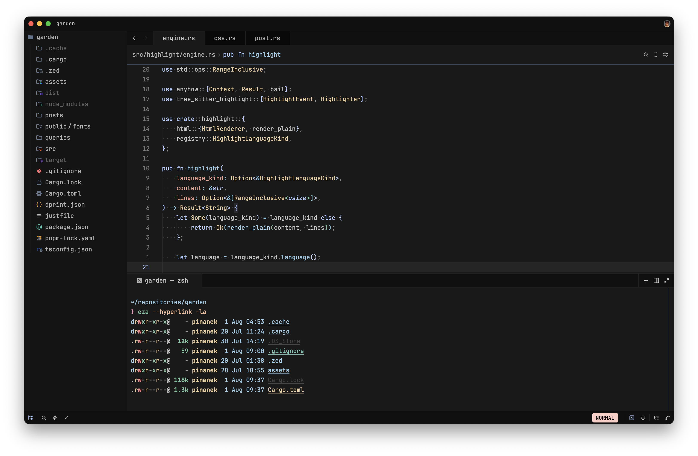

# 😻 Catppina

<p align="center">
  <strong>A custom Catppuccin-inspired color palette for my favorite applications.</strong>
</p>

<p align="center">
  
</p>

## ✨ About

**Catppina** is a collection of themes based on the
[Catppuccin](https://catppuccin.com) ecosystem,rebuilt using my custom dark
color palette.

Generated themes are available in the [`dist`](dist/) directory.

## 🌈 Color palette

### Light

<table>
  <thead>
    <tr>
      <th width="180px" align="left">Color</th>
      <th width="50px" align="center">HEX</th>
      <th width="150px" align="center">RGB</th>
      <th width="270px" align="center">HSL</th>
      <th width="350px" align="center">OKLCH</th>
    </tr>
  </thead>
  <tbody>
    <tr>
      <td>
         <strong>Rosewater</strong>
      </td>
      <td align="center"><code>#974036</code></td>
      <td align="center"><code>rgb(151,64,54)</code></td>
      <td align="center"><code>hsl(6 47% 40%)</code></td>
      <td align="center"><code>oklch(48.6% 0.119 28.8)</code></td>
    </tr>
    <tr>
      <td>
         <strong>Flamingo</strong>
      </td>
      <td align="center"><code>#9f383f</code></td>
      <td align="center"><code>rgb(159,56,63)</code></td>
      <td align="center"><code>hsl(356 48% 42%)</code></td>
      <td align="center"><code>oklch(48.9% 0.137 19.8)</code></td>
    </tr>
    <tr>
      <td>
         <strong>Pink</strong>
      </td>
      <td align="center"><code>#9c356a</code></td>
      <td align="center"><code>rgb(156,53,106)</code></td>
      <td align="center"><code>hsl(329 49% 41%)</code></td>
      <td align="center"><code>oklch(49.3% 0.147 352.0)</code></td>
    </tr>
    <tr>
      <td>
         <strong>Mauve</strong>
      </td>
      <td align="center"><code>#41599c</code></td>
      <td align="center"><code>rgb(65,89,156)</code></td>
      <td align="center"><code>hsl(224 41% 43%)</code></td>
      <td align="center"><code>oklch(47.8% 0.112 267.3)</code></td>
    </tr>
    <tr>
      <td>
         <strong>Red</strong>
      </td>
      <td align="center"><code>#a72f3a</code></td>
      <td align="center"><code>rgb(167,47,58)</code></td>
      <td align="center"><code>hsl(354 56% 42%)</code></td>
      <td align="center"><code>oklch(49.2% 0.156 20.1)</code></td>
    </tr>
    <tr>
      <td>
         <strong>Maroon</strong>
      </td>
      <td align="center"><code>#984133</code></td>
      <td align="center"><code>rgb(152,65,51)</code></td>
      <td align="center"><code>hsl(8 50% 40%)</code></td>
      <td align="center"><code>oklch(48.8% 0.120 31.1)</code></td>
    </tr>
    <tr>
      <td>
         <strong>Peach</strong>
      </td>
      <td align="center"><code>#944600</code></td>
      <td align="center"><code>rgb(148,70,0)</code></td>
      <td align="center"><code>hsl(28 100% 29%)</code></td>
      <td align="center"><code>oklch(48.5% 0.125 51.9)</code></td>
    </tr>
    <tr>
      <td>
         <strong>Yellow</strong>
      </td>
      <td align="center"><code>#765702</code></td>
      <td align="center"><code>rgb(118,87,2)</code></td>
      <td align="center"><code>hsl(44 97% 24%)</code></td>
      <td align="center"><code>oklch(47.6% 0.097 84.3)</code></td>
    </tr>
    <tr>
      <td>
         <strong>Green</strong>
      </td>
      <td align="center"><code>#186846</code></td>
      <td align="center"><code>rgb(24,104,70)</code></td>
      <td align="center"><code>hsl(154 62% 25%)</code></td>
      <td align="center"><code>oklch(46.1% 0.094 160.2)</code></td>
    </tr>
    <tr>
      <td>
         <strong>Teal</strong>
      </td>
      <td align="center"><code>#00675f</code></td>
      <td align="center"><code>rgb(0,103,95)</code></td>
      <td align="center"><code>hsl(175 100% 20%)</code></td>
      <td align="center"><code>oklch(46.2% 0.081 185.6)</code></td>
    </tr>
    <tr>
      <td>
         <strong>Sky</strong>
      </td>
      <td align="center"><code>#116285</code></td>
      <td align="center"><code>rgb(17,98,133)</code></td>
      <td align="center"><code>hsl(198 77% 29%)</code></td>
      <td align="center"><code>oklch(46.8% 0.091 233.4)</code></td>
    </tr>
    <tr>
      <td>
         <strong>Sapphire</strong>
      </td>
      <td align="center"><code>#00647e</code></td>
      <td align="center"><code>rgb(0,100,126)</code></td>
      <td align="center"><code>hsl(192 100% 25%)</code></td>
      <td align="center"><code>oklch(46.7% 0.088 223.7)</code></td>
    </tr>
    <tr>
      <td>
         <strong>Blue</strong>
      </td>
      <td align="center"><code>#16618b</code></td>
      <td align="center"><code>rgb(22,97,139)</code></td>
      <td align="center"><code>hsl(202 73% 32%)</code></td>
      <td align="center"><code>oklch(47.0% 0.097 239.3)</code></td>
    </tr>
    <tr>
      <td>
         <strong>Lavender</strong>
      </td>
      <td align="center"><code>#485a8c</code></td>
      <td align="center"><code>rgb(72,90,140)</code></td>
      <td align="center"><code>hsl(224 32% 42%)</code></td>
      <td align="center"><code>oklch(47.6% 0.084 268.1)</code></td>
    </tr>
    <tr>
      <td>
         <strong>Text</strong>
      </td>
      <td align="center"><code>#303033</code></td>
      <td align="center"><code>rgb(48,48,51)</code></td>
      <td align="center"><code>hsl(240 3% 19%)</code></td>
      <td align="center"><code>oklch(31.0% 0.005 286.1)</code></td>
    </tr>
    <tr>
      <td>
         <strong>Subtext 1</strong>
      </td>
      <td align="center"><code>#49494d</code></td>
      <td align="center"><code>rgb(73,73,77)</code></td>
      <td align="center"><code>hsl(240 3% 29%)</code></td>
      <td align="center"><code>oklch(40.7% 0.007 286.1)</code></td>
    </tr>
    <tr>
      <td>
         <strong>Subtext 0</strong>
      </td>
      <td align="center"><code>#5b5b5f</code></td>
      <td align="center"><code>rgb(91,91,95)</code></td>
      <td align="center"><code>hsl(240 2% 36%)</code></td>
      <td align="center"><code>oklch(47.3% 0.006 286.2)</code></td>
    </tr>
    <tr>
      <td>
         <strong>Overlay 2</strong>
      </td>
      <td align="center"><code>#737378</code></td>
      <td align="center"><code>rgb(115,115,120)</code></td>
      <td align="center"><code>hsl(240 2% 46%)</code></td>
      <td align="center"><code>oklch(55.7% 0.008 286.1)</code></td>
    </tr>
    <tr>
      <td>
         <strong>Overlay 1</strong>
      </td>
      <td align="center"><code>#89898e</code></td>
      <td align="center"><code>rgb(137,137,142)</code></td>
      <td align="center"><code>hsl(240 2% 55%)</code></td>
      <td align="center"><code>oklch(63.2% 0.007 286.2)</code></td>
    </tr>
    <tr>
      <td>
         <strong>Overlay 0</strong>
      </td>
      <td align="center"><code>#9d9da2</code></td>
      <td align="center"><code>rgb(157,157,162)</code></td>
      <td align="center"><code>hsl(240 3% 63%)</code></td>
      <td align="center"><code>oklch(69.8% 0.007 286.2)</code></td>
    </tr>
    <tr>
      <td>
         <strong>Surface 2</strong>
      </td>
      <td align="center"><code>#d8d8da</code></td>
      <td align="center"><code>rgb(216,216,218)</code></td>
      <td align="center"><code>hsl(240 3% 85%)</code></td>
      <td align="center"><code>oklch(88.3% 0.003 286.3)</code></td>
    </tr>
    <tr>
      <td>
         <strong>Surface 1</strong>
      </td>
      <td align="center"><code>#e3e3e5</code></td>
      <td align="center"><code>rgb(227,227,229)</code></td>
      <td align="center"><code>hsl(240 4% 89%)</code></td>
      <td align="center"><code>oklch(91.6% 0.003 286.3)</code></td>
    </tr>
    <tr>
      <td>
         <strong>Surface 0</strong>
      </td>
      <td align="center"><code>#eeeeef</code></td>
      <td align="center"><code>rgb(238,238,239)</code></td>
      <td align="center"><code>hsl(240 3% 94%)</code></td>
      <td align="center"><code>oklch(94.9% 0.001 286.4)</code></td>
    </tr>
    <tr>
      <td>
         <strong>Base</strong>
      </td>
      <td align="center"><code>#f7f7f8</code></td>
      <td align="center"><code>rgb(247,247,248)</code></td>
      <td align="center"><code>hsl(240 7% 97%)</code></td>
      <td align="center"><code>oklch(97.6% 0.001 286.4)</code></td>
    </tr>
    <tr>
      <td>
         <strong>Mantle</strong>
      </td>
      <td align="center"><code>#f1f1f2</code></td>
      <td align="center"><code>rgb(241,241,242)</code></td>
      <td align="center"><code>hsl(240 4% 95%)</code></td>
      <td align="center"><code>oklch(95.8% 0.001 286.4)</code></td>
    </tr>
    <tr>
      <td>
         <strong>Crust</strong>
      </td>
      <td align="center"><code>#e9e9eb</code></td>
      <td align="center"><code>rgb(233,233,235)</code></td>
      <td align="center"><code>hsl(240 5% 92%)</code></td>
      <td align="center"><code>oklch(93.5% 0.003 286.3)</code></td>
    </tr>
  </tbody>
</table>

### Dark

<table>
  <thead>
    <tr>
      <th width="180px" align="left">Color</th>
      <th width="50px" align="center">HEX</th>
      <th width="150px" align="center">RGB</th>
      <th width="270px" align="center">HSL</th>
      <th width="350px" align="center">OKLCH</th>
    </tr>
  </thead>
  <tbody>
    <tr>
      <td>
         <strong>Rosewater</strong>
      </td>
      <td align="center"><code>#ffcdc7</code></td>
      <td align="center"><code>rgb(255,205,199)</code></td>
      <td align="center"><code>hsl(6 100% 89%)</code></td>
      <td align="center"><code>oklch(89.0% 0.058 26.2)</code></td>
    </tr>
    <tr>
      <td>
         <strong>Flamingo</strong>
      </td>
      <td align="center"><code>#ffafaf</code></td>
      <td align="center"><code>rgb(255,175,175)</code></td>
      <td align="center"><code>hsl(0 100% 84%)</code></td>
      <td align="center"><code>oklch(83.1% 0.094 19.3)</code></td>
    </tr>
    <tr>
      <td>
         <strong>Pink</strong>
      </td>
      <td align="center"><code>#e99cba</code></td>
      <td align="center"><code>rgb(233,156,186)</code></td>
      <td align="center"><code>hsl(337 64% 76%)</code></td>
      <td align="center"><code>oklch(77.7% 0.099 354.6)</code></td>
    </tr>
    <tr>
      <td>
         <strong>Mauve</strong>
      </td>
      <td align="center"><code>#b5ccff</code></td>
      <td align="center"><code>rgb(181,204,255)</code></td>
      <td align="center"><code>hsl(221 100% 85%)</code></td>
      <td align="center"><code>oklch(84.6% 0.076 265.8)</code></td>
    </tr>
    <tr>
      <td>
         <strong>Red</strong>
      </td>
      <td align="center"><code>#ff9596</code></td>
      <td align="center"><code>rgb(255,149,150)</code></td>
      <td align="center"><code>hsl(359 100% 79%)</code></td>
      <td align="center"><code>oklch(78.1% 0.128 19.8)</code></td>
    </tr>
    <tr>
      <td>
         <strong>Maroon</strong>
      </td>
      <td align="center"><code>#f1a290</code></td>
      <td align="center"><code>rgb(241,162,144)</code></td>
      <td align="center"><code>hsl(11 78% 75%)</code></td>
      <td align="center"><code>oklch(78.5% 0.098 33.4)</code></td>
    </tr>
    <tr>
      <td>
         <strong>Peach</strong>
      </td>
      <td align="center"><code>#fbc19d</code></td>
      <td align="center"><code>rgb(251,193,157)</code></td>
      <td align="center"><code>hsl(23 92% 80%)</code></td>
      <td align="center"><code>oklch(85.5% 0.082 53.1)</code></td>
    </tr>
    <tr>
      <td>
         <strong>Yellow</strong>
      </td>
      <td align="center"><code>#e9cc9c</code></td>
      <td align="center"><code>rgb(233,204,156)</code></td>
      <td align="center"><code>hsl(37 64% 76%)</code></td>
      <td align="center"><code>oklch(85.8% 0.071 80.1)</code></td>
    </tr>
    <tr>
      <td>
         <strong>Green</strong>
      </td>
      <td align="center"><code>#7fc7a4</code></td>
      <td align="center"><code>rgb(127,199,164)</code></td>
      <td align="center"><code>hsl(151 39% 64%)</code></td>
      <td align="center"><code>oklch(77.2% 0.089 162.3)</code></td>
    </tr>
    <tr>
      <td>
         <strong>Teal</strong>
      </td>
      <td align="center"><code>#7ecebe</code></td>
      <td align="center"><code>rgb(126,206,190)</code></td>
      <td align="center"><code>hsl(168 45% 65%)</code></td>
      <td align="center"><code>oklch(79.5% 0.082 179.9)</code></td>
    </tr>
    <tr>
      <td>
         <strong>Sky</strong>
      </td>
      <td align="center"><code>#8fc9e6</code></td>
      <td align="center"><code>rgb(143,201,230)</code></td>
      <td align="center"><code>hsl(200 64% 73%)</code></td>
      <td align="center"><code>oklch(80.6% 0.072 230.4)</code></td>
    </tr>
    <tr>
      <td>
         <strong>Sapphire</strong>
      </td>
      <td align="center"><code>#94d1e5</code></td>
      <td align="center"><code>rgb(148,209,229)</code></td>
      <td align="center"><code>hsl(195 61% 74%)</code></td>
      <td align="center"><code>oklch(82.6% 0.068 220.3)</code></td>
    </tr>
    <tr>
      <td>
         <strong>Blue</strong>
      </td>
      <td align="center"><code>#9ccfe9</code></td>
      <td align="center"><code>rgb(156,207,233)</code></td>
      <td align="center"><code>hsl(200 64% 76%)</code></td>
      <td align="center"><code>oklch(82.8% 0.064 230.6)</code></td>
    </tr>
    <tr>
      <td>
         <strong>Lavender</strong>
      </td>
      <td align="center"><code>#c1d0f2</code></td>
      <td align="center"><code>rgb(193,208,242)</code></td>
      <td align="center"><code>hsl(222 65% 85%)</code></td>
      <td align="center"><code>oklch(85.7% 0.050 266.5)</code></td>
    </tr>
    <tr>
      <td>
         <strong>Text</strong>
      </td>
      <td align="center"><code>#c3c3c4</code></td>
      <td align="center"><code>rgb(195,195,196)</code></td>
      <td align="center"><code>hsl(240 1% 77%)</code></td>
      <td align="center"><code>oklch(81.7% 0.001 286.4)</code></td>
    </tr>
    <tr>
      <td>
         <strong>Subtext 1</strong>
      </td>
      <td align="center"><code>#b2b2b3</code></td>
      <td align="center"><code>rgb(178,178,179)</code></td>
      <td align="center"><code>hsl(240 1% 70%)</code></td>
      <td align="center"><code>oklch(76.4% 0.001 286.4)</code></td>
    </tr>
    <tr>
      <td>
         <strong>Subtext 0</strong>
      </td>
      <td align="center"><code>#b3b3b4</code></td>
      <td align="center"><code>rgb(179,179,180)</code></td>
      <td align="center"><code>hsl(240 1% 70%)</code></td>
      <td align="center"><code>oklch(76.7% 0.001 286.4)</code></td>
    </tr>
    <tr>
      <td>
         <strong>Overlay 2</strong>
      </td>
      <td align="center"><code>#939394</code></td>
      <td align="center"><code>rgb(147,147,148)</code></td>
      <td align="center"><code>hsl(240 0% 58%)</code></td>
      <td align="center"><code>oklch(66.4% 0.001 286.4)</code></td>
    </tr>
    <tr>
      <td>
         <strong>Overlay 1</strong>
      </td>
      <td align="center"><code>#757576</code></td>
      <td align="center"><code>rgb(117,117,118)</code></td>
      <td align="center"><code>hsl(240 0% 46%)</code></td>
      <td align="center"><code>oklch(56.3% 0.002 286.4)</code></td>
    </tr>
    <tr>
      <td>
         <strong>Overlay 0</strong>
      </td>
      <td align="center"><code>#636364</code></td>
      <td align="center"><code>rgb(99,99,100)</code></td>
      <td align="center"><code>hsl(240 1% 39%)</code></td>
      <td align="center"><code>oklch(50.0% 0.002 286.3)</code></td>
    </tr>
    <tr>
      <td>
         <strong>Surface 2</strong>
      </td>
      <td align="center"><code>#434344</code></td>
      <td align="center"><code>rgb(67,67,68)</code></td>
      <td align="center"><code>hsl(240 1% 26%)</code></td>
      <td align="center"><code>oklch(38.3% 0.002 286.3)</code></td>
    </tr>
    <tr>
      <td>
         <strong>Surface 1</strong>
      </td>
      <td align="center"><code>#323233</code></td>
      <td align="center"><code>rgb(50,50,51)</code></td>
      <td align="center"><code>hsl(240 1% 20%)</code></td>
      <td align="center"><code>oklch(31.8% 0.002 286.3)</code></td>
    </tr>
    <tr>
      <td>
         <strong>Surface 0</strong>
      </td>
      <td align="center"><code>#212122</code></td>
      <td align="center"><code>rgb(33,33,34)</code></td>
      <td align="center"><code>hsl(240 1% 13%)</code></td>
      <td align="center"><code>oklch(24.8% 0.002 286.3)</code></td>
    </tr>
    <tr>
      <td>
         <strong>Base</strong>
      </td>
      <td align="center"><code>#19191a</code></td>
      <td align="center"><code>rgb(25,25,26)</code></td>
      <td align="center"><code>hsl(240 2% 10%)</code></td>
      <td align="center"><code>oklch(21.4% 0.002 286.2)</code></td>
    </tr>
    <tr>
      <td>
         <strong>Mantle</strong>
      </td>
      <td align="center"><code>#141415</code></td>
      <td align="center"><code>rgb(20,20,21)</code></td>
      <td align="center"><code>hsl(240 2% 8%)</code></td>
      <td align="center"><code>oklch(19.2% 0.002 286.2)</code></td>
    </tr>
    <tr>
      <td>
         <strong>Crust</strong>
      </td>
      <td align="center"><code>#101011</code></td>
      <td align="center"><code>rgb(16,16,17)</code></td>
      <td align="center"><code>hsl(240 3% 6%)</code></td>
      <td align="center"><code>oklch(17.3% 0.002 286.2)</code></td>
    </tr>
  </tbody>
</table>

## 📦 Ports

| Application                                                                        | Theme files                                                     |
| ---------------------------------------------------------------------------------- | --------------------------------------------------------------- |
| 🧙 [btop](https://github.com/aristocratos/btop)                                    | [`dist/btop`](dist/btop/)                                       |
| ➕ [delta](https://github.com/dandavison/delta)                                    | [`dist/delta`](dist/delta/)                                     |
| 🐟 [fish](https://fishshell.com)                                                   | [`dist/fish`](dist/fish/)                                       |
| 🌸 [fzf](https://github.com/junegunn/fzf)                                          | [`dist/fzf`](dist/fzf/)                                         |
| 👻 [Ghostty](https://ghostty.org)                                                  | [`dist/ghostty`](dist/ghostty/)                                 |
| 🍴 [GitUI](https://github.com/gitui-org/gitui)                                     | [`dist/gitui`](dist/gitui/)                                     |
| 🌟 [Glamour](https://github.com/charmbracelet/glamour)                             | [`dist/glamour`](dist/glamour/)                                 |
| ➿ [Helix](https://helix-editor.com)                                               | [`dist/helix`](dist/helix/)                                     |
| 🍴 [lazygit](https://github.com/jesseduffield/lazygit)                             | [`dist/lazygit`](dist/lazygit/)                                 |
| 📮 [Posting](https://github.com/darrenburns/posting)                               | [`dist/posting`](dist/posting/)                                 |
| 💻 [VS Code](https://code.visualstudio.com)                                        | [`dist/vscode`](dist/vscode/)                                   |
| 💥 [Yazi](https://yazi-rs.github.io)                                               | [`dist/yazi`](dist/yazi/)                                       |
| 🦀 [Zed](https://zed.dev)                                                          | [`dist/zed`](dist/zed/)                                         |
| 🧩 [Zellij](https://zellij.dev)                                                    | [`dist/zellij`](dist/zellij/)                                   |
| 🪗 [zsh-syntax-highlighting](https://github.com/zsh-users/zsh-syntax-highlighting) | [`dist/zsh-syntax-highlighting`](dist/zsh-syntax-highlighting/) |

## 🛠️ Building

### Requirements

- [just](https://github.com/casey/just)
- [Whiskers](https://github.com/catppuccin/whiskers)
- [Node.js](https://nodejs.org) LTS
- [pnpm](https://pnpm.io)

### Build all ports

```sh
just build
```

### Build a specific port

```sh
just build_helix
```

### List available recipes

```sh
just
```

## 📁 Repository structure

```text
.
├── assets/
├── dist/
├── ports/
├── scripts/
├── colors.json
└── justfile
```

- `assets`: README images and color previews.
- `dist`: generated theme files.
- `ports`: upstream Catppuccin port templates.
- `scripts`: additional theme conversion scripts.
- `colors.json`: Catppina color palette.
- `justfile`: build recipes.

## ❤️ Credits

- [Catppuccin](https://catppuccin.com) for the original color palette,
  templates,ports,and ecosystem.
- The maintainers of every supported application and Catppuccin port.
